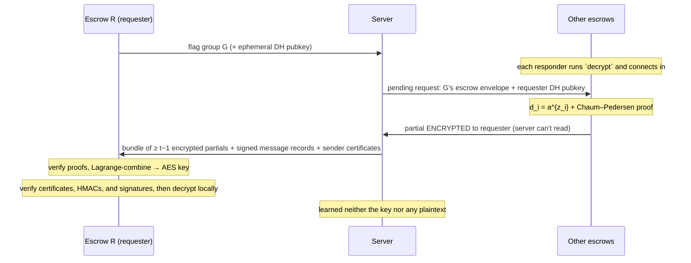

# Project Accountability

**Guillermo Ramos Santos · Itamar Fink** — LMU Cryptography, SS 2026

[](../../actions/workflows/docs.yml)
📄 [Documentation (PDF)](../../releases/download/docs-latest/documentation.pdf) ·
[Proposal (PDF)](../../releases/download/docs-latest/proposal.pdf)

An end-to-end encrypted group-messaging system with **accountable, threshold key
escrow**: chats are private by default, but the configured threshold of
independent escrow authorities — never the server, and never any single party —
can cooperatively recover a flagged group's key for review.

---

## Context & use case

End-to-end encryption and lawful accountability are usually presented as
opposites: either the operator can read everything (no privacy) or no one can
(no recourse against abuse). This project explores the middle ground with
**threshold cryptography**.

Messages in a group are encrypted with a group key that the server never sees.
Recovering that key requires **`t` of `n` escrow authorities** (guardians) to
agree — modelling, e.g., a request that only takes effect when a configured
quorum of independent oversight bodies participates. No smaller coalition, and
no single actor, can decrypt anything. The server is treated as **honest-but-curious**: it
relays and stores ciphertext but is never trusted with plaintext or keys.

`t` and `n` are program constants: `THRESHOLD_T` and `THRESHOLD_N` in
[`include-shared/constants.hpp`](include-shared/constants.hpp). They may be
changed, but the authorized escrow roster and per-escrow server-authentication
secrets in `include-shared/escrow_security.hpp`, plus the escrow configuration
files, must be changed to match. They are not per-group TUI settings.

> Current checkout: the program is configured for `t = 3`, `n = 5`, with
> authorized escrow IDs `1` through `5` and five matching escrow configuration
> files. Keep those values in sync if you change the threshold constants.

## Actors & trust model

| Actor | Binary | Role | Trusted with |
|---|---|---|---|
| **Server** | `auth_server` | Auth, message relay & storage, DKG/recovery coordination | Nothing secret — sees only ciphertext and public keys |
| **User** | `auth_user` | Registers/logs in, creates groups, chats (TUI) | Their own keys and group memberships |
| **Escrow** (×`n`) | `escrow` | Holds one share of each group's threshold key | One Shamir share — useless alone |

Security goals: message **confidentiality** and **integrity** end-to-end;
**authentication** of users; recovery that is **quorum-gated** (`< t` escrows
learn nothing) and **server-blind** (the recovered key is revealed only to the
requesting escrow). This remains a shared-group-secret design rather than a
sender-key design. Each normal encrypted record is additionally RSA-PSS
signed by its sender, giving individual authorship under the server's
certificate authority; signatures do not prevent replay, deletion, or
reordering by the server.

## Cryptographic overview

Five building blocks compose the system. (A companion document will give the
step-by-step detail, message formats, and key inventory; this is the map.)

### 1. Authentication — user ↔ server
Every connection starts with a signed ephemeral **Diffie–Hellman** exchange:
the server signs its DH public value with its long-term RSA signing key, and the
client verifies that signature with the server public key configured locally.
Both sides derive a fresh **AES-CBC + HMAC** channel from the DH shared secret.

Registration is deliberately small: the server sends a random salt; the client
sends `H(password || salt)` through that channel; and the server stores that
salt and hash. Login repeats the same salt-and-hash check. There is no
time-based password, PRG seed, or extra pepper. After a successful registration,
the client generates two RSA key pairs (one signing pair and one encryption
pair), sends the two public keys, and receives a server-signed certificate that
binds both keys to its account name.

### 2. Group creation — one public-key envelope per member
The creator first starts the group's escrow DKG and waits until its threshold
public key is available. It then samples the group secret `K_G`. For every
member, it fetches the member's server-signed certificate and creates one
envelope:

`C_member = K_G^e mod n`  (with the member's RSA public key `(n, e)`)

That is exactly the basic “encrypt a copy of the group key with each member's
public key” design. The implementation directly uses the RSA public operation
already used elsewhere in the project; there is no OAEP wrapper or additional
RSA encryption helper. The creator also encrypts the same `K_G` under the DKG
threshold public key for the separate escrow envelope, signs the full creation
request with its RSA signing key, and sends it to the server. The server verifies
the signature and stores the membership list and opaque envelopes.

### 3. Threshold key escrow — distributed key generation
For each group the `n` escrows run a **Distributed Key Generation** protocol
(Feldman-committed **Shamir** sharing with shares protected by the escrow-only
AES-CBC + HMAC mesh). They
jointly produce a group **threshold public key** `pk = G^s`; the secret `s` is
never assembled — each escrow holds only a share `z_i`, and even the server
learns only `pk`. The creator then **ElGamal-encrypts the group secret under
`pk`** (the "escrow envelope") and stores it with the group.

### 4. Group messaging — symmetric encryption with the group secret
When sending or fetching messages, a member retrieves only its own RSA envelope
and applies its RSA private-key operation `K_G = C_member^d mod n` to recover
`K_G`. `K_G` deterministically derives the AES and HMAC keys used for the chat.
Each message is encrypted with **AES-CBC** and authenticated with **HMAC**
before it reaches the server. The sender then RSA-PSS-signs a canonical,
length-prefixed record containing
`"group-message-signature-v1"`, the group ID, authenticated sender ID, IV,
ciphertext, and HMAC. The server derives the sender ID from the authenticated
session, verifies the signature with that user's stored certificate, and stores
only the IV, ciphertext, HMAC, signature, sender identifier, and message
identifier. A recipient verifies the HMAC, fetches and caches the sender's
server-certified signing public key, verifies the RSA-PSS signature, and then
decrypts. Members fetch incrementally, only messages newer than their last seen
identifier.

### 5. Accountable recovery — escrow-initiated, server-blind
Recovery is started by an escrow, not the server:



Each responder encrypts its partial decryption to the requester under a DH
secret the server cannot compute, so the server only ever relays opaque blobs.
The requester contributes its own share, so it needs `t − 1` others to
cooperate — fewer than `t` and recovery is information-theoretically impossible.
The bundle contains one server-signed user certificate for each message sender;
after recovery, the requesting escrow validates that certificate and the
sender's RSA-PSS signature before accepting a plaintext.

## Repository structure

```
include-shared/     Shared headers: messages, config, constants (DL group, thresholds), key loaders
                    escrow_security.hpp: authorized escrow roster + per-escrow server-auth secrets
src-shared/         Their implementations (message (de)serialization, utils, key I/O)
include/ , src/
  pkg/              Application logic
    server.cxx        Auth, relay/storage, DKG + recovery coordination
    user.cxx          Registration/login, group create/send/fetch, escrow envelope
    escrow.cxx        DKG participation, flagging, partial decryption
    vote.cxx          ElGamal, Chaum–Pedersen ZKP, Lagrange combination
    escrow_mesh.hpp   Escrow-only mesh secret protecting DKG shares in transit;
                      included by escrow.cxx alone, never by server or user code
  drivers/          Crypto (crypto_driver), SQLite (db_driver), networking (network_driver),
                    CLI/REPL, and the FTXUI front-end (drivers/tui)
  cmd/              Entry points → auth_server, auth_user, escrow
config/             Ready-made JSON configs for the server, users, and escrows
keys/               Key material (generated at runtime)
test/               doctest unit + negative-path tests
docs/               Project proposal and the in-depth implementation design doc
cmake/              Dependency modules (Boost, Crypto++, SQLite, FTXUI, doctest)
```

## Building

A C++20 compiler and CMake ≥ 3.14 are required. The modules in `cmake/` expect
**Boost** (thread, filesystem, log), **Crypto++**, **SQLite3**, and **ncurses**
to be installed locally, and download **FTXUI** and **doctest** at configure
time — so the first `cmake ..` needs network access. FTXUI is fetched from its
`main` branch rather than a fixed tag, so the exact version is whatever is
current when you configure.

```sh
mkdir -p build && cd build
cmake ..
make -j
```

This produces `auth_server`, `auth_user`, `escrow`, and `unit_tests` in `build/`.

## Running

Run everything from `build/` (the sample configs use paths relative to it). The
default endpoint is `127.0.0.1:8080`.

**1. Start the server** (REPL commands: `users`, `reset`):
```sh
./auth_server 8080 ../config/server-config.json
```

**2. Start the escrows** — one terminal for every configured and authorized
escrow ID. The checked-in 3-of-5 configuration requires all five:
```sh
./escrow ../config/escrow0-config.json
./escrow ../config/escrow1-config.json
./escrow ../config/escrow2-config.json
./escrow ../config/escrow3-config.json
./escrow ../config/escrow4-config.json
```
If you change `THRESHOLD_N`, update the roster, per-escrow secrets, and this
command list to match.
Escrow REPL commands: `keygen <group-id>` (join that group's DKG),
`decrypt` (respond to a recovery request), `flag <group-id>`
(initiate recovery of a group).

**3. Start users** — each launches the FTXUI chat client:
```sh
./auth_user ../config/user0-config.json
```
In the TUI: add a server (choosing *Register* the first time, *Login*
afterwards), create or select a group, and chat.

**Creating a group** kicks off a per-group DKG: after a user requests creation,
the escrows must each run `keygen <group-id>` so the `n` guardians can
generate that group's threshold key; the group is finalized once the DKG
completes.

**Recovering a group** (accountability path): one escrow runs
`flag <group-id>`, and at least `t − 1` other escrows run
`decrypt` to contribute their partial decryptions. The flagging escrow then
recovers the group key and prints the decrypted messages — locally, without the
server ever seeing them.

## Tests

```sh
cd build && ./unit_tests        # or, from anywhere: ./test.sh
```
Covers the crypto primitives, message serialization, threshold decryption, and
a suite of negative / graceful-failure cases (wrong keys, tampering, wrong
group, bad authentication).

## Further documentation

`docs/documentation.tex` is the implementation-level document: it details each
protocol step, the key inventory, the threshold configuration, and the security
limitations of this educational implementation. `docs/proposal.tex` is the
original project proposal.

The PDFs are not checked in: a GitHub Actions workflow
([`.github/workflows/docs.yml`](.github/workflows/docs.yml)) compiles both
`.tex` files on every push to `main` that touches `docs/`, and publishes them to
the [`docs-latest` release](../../releases/tag/docs-latest). To build locally:

```sh
cd docs && latexmk -pdf documentation.tex proposal.tex
```

## Authors

This project was designed and built as a pair project by:

- **Guillermo Ramos Santos**
- **Itamar Fink**

It was developed as the final project for the *Cryptography* practical course
at LMU Munich (summer semester 2026), building on the course's earlier
secure-messaging project skeleton.

> ⚠️ **Educational prototype.** This code has not been audited and contains demo
> secrets in the source tree (see `include-shared/escrow_security.hpp`). Do not
> use it to protect real communications.
